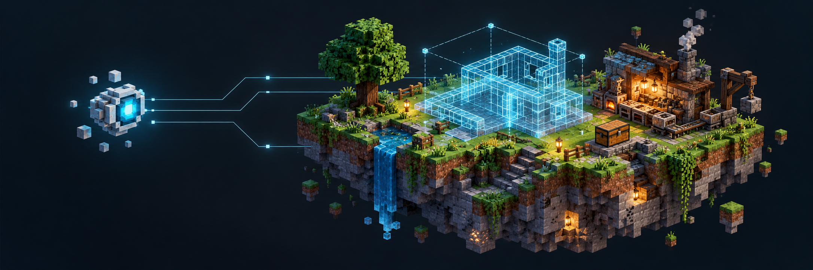
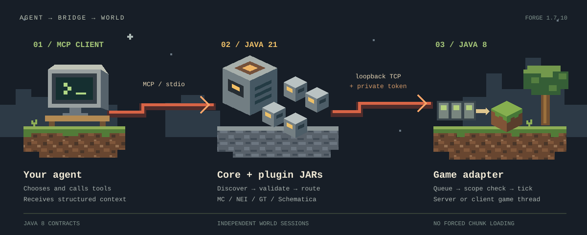

<p align="center">
  
</p>

<h1 align="center">Minecraft Agent Tools</h1>

<p align="center"><strong>Give your AI agent a window into Minecraft.</strong><br>
Inspect the world. Explore recipes. Plan what to build next.</p>

<p align="center">
  <a href=".github/workflows/ci.yml"></a>
  
  
  
  <a href="LICENSE"></a>
</p>

<p align="center">
  <strong>English</strong> · <a href="README.ru.md">Русский</a><br>
  <a href="#quick-start">Quick start</a> · <a href="docs/architecture.md">Architecture</a> · <a href="docs/tools.md">Tool reference</a> · <a href="CONTRIBUTING.md">Contributing</a>
</p>

---

An independent **MCP server and Forge 1.7.10 adapters** that expose structured game
state to an AI agent. Four removable providers connect vanilla Minecraft,
NotEnoughItems, GregTech and Schematica to any client supporting this project's MCP
stdio profile.

**Experimental, with implemented tools and isolated tests.** In-game validation is
still partial: a recorded GTNH client startup and `schematic_status` response do
not establish end-to-end gameplay compatibility. See the [validation record](docs/startup-check.md).
The cover above is concept art, not a game screenshot.

## What you can ask

| Ask your agent… | What the tools provide |
| --- | --- |
| “What's around my base, and what's in that chest?” | Player state, terrain, entities, inventories and block inspection. |
| “Where is that dropped item?” | Entity lookup and a temporary particle marker visible to the selected player. |
| “How do I make this, and what uses it?” | Item search, recipes and usages through installed NEI handlers. |
| “What does this GregTech recipe need?” | Items, fluids, EU/t, duration and machine information from the installed registries. |
| “Lay out a workshop with room to expand.” | Named Schematica ghost plans, material counts and `.schematic` / JSON export. |

These are example requests, not recorded demo transcripts. The agent chooses and
calls tools; it still needs the corresponding adapter, credentials and game session.
**Players move, craft and place real blocks themselves.** Markers and blueprints
provide guidance; autonomous movement and building are outside the current scope.

## Four integrations, one endpoint

| Provider | Tools | Install the adapter on | Start with |
| --- | ---: | --- | --- |
| **Minecraft** | 18 | Forge server | `list_sessions` |
| **NEI** | 5 | Client with NEI GTNH | `nei_status` |
| **GregTech** | 12 | Server / integrated server with GTNH GregTech | `gt_status` |
| **Schematica** | 7 | Client with Schematica GTNH | `schematic_status` |

Each provider lives in its own JAR. Remove it from `plugins/` and restart the MCP
process to remove its tools. An empty plugin directory is valid. The core has no
built-in Minecraft tools and does not require Minecraft Harness. A separately
opted-in Harness extension adds per-plan chat widgets.

## How it works

<p align="center">
  
</p>

The design keeps modern agent infrastructure outside the legacy game runtime:

- **Two Java runtimes.** Java 21 runs the MCP process; Java 8 contracts and adapters
  run inside Forge. The Forge JARs never embed the MCP core or modern Gson.
- **Explicit thread ownership.** Socket workers handle transport. Queued game reads
  execute on the appropriate tick thread, with bounded queues and expiry.
- **World-scoped operations.** Session and dimension checks reject stale requests
  after a world transition. Each integration has its own scope.
- **Honest observations.** Unloaded chunks stay unknown. Truncated results and
  unavailable mod data are reported explicitly.

The [architecture guide](docs/architecture.md) explains the module boundaries,
tradeoffs and extension interface.

## Quick start

**Prerequisites:** JDK 21 to run Gradle and the MCP core; Forge 1.7.10 for the game.
Gradle uses a Java 8 toolchain for the adapters. The first build needs internet
access to download dependencies and the legacy Forge toolchain.

```sh
git clone https://github.com/sorivma/minecraft-agent-tools.git
cd minecraft-agent-tools
./gradlew build :mcp-server:installDist
```

On Windows PowerShell, use `.\gradlew.bat build :mcp-server:installDist`.
Set `JAVA_HOME` to a **JDK 21** before building. No neighboring checkout is required.

1. Find the assembled distribution in `build/bundle/`.
2. For vanilla observations, install the JAR from `forge/` into the server's `mods/`.
   Keep `plugins/minecraft-tools.jar`; remove unused provider JARs from this distribution.
3. Start the game/server yourself. Copy `bridge.token` from
   `config/minecraftagenttools.cfg` into your MCP client's private environment.
4. Configure the client to run Java 21 with `-jar /absolute/path/to/bundle/core.jar`.
   Set `MAT_TOKEN` and, if changed, `MAT_PORT` (default `25576`).
5. Reconnect the MCP client and ask it to call `list_sessions`, then `observe`
   using the returned session, dimension and player UUID.

The MCP process must run on the same machine as its adapter: bridges listen on
loopback. A token grants administrative observation access; keep it private.

**[Complete installation guide →](docs/getting-started.md)** — configuration example,
bundle layout, optional integrations and troubleshooting.

## Scope and evidence

| Available in the code | Still requires care or validation |
| --- | --- |
| MCP initialization, tool discovery and calls over stdio | This is a focused MCP profile, not every MCP feature. |
| Observation, recipes, temporary markers and ghost plans | End-to-end checks on actual servers and modpacks remain partial. |
| Session checks, bounded scans and pagination | Pages are separate observations, not an atomic snapshot of the world. |
| GregTech and StructureLib inspection | No complete multiblock planner or simulation of arbitrary addons. |
| Schematica authoring, persistence and export | Mod-specific rendering and restore workflows need in-game verification. |

`build` runs isolated tests, formatting checks and checks of the **actual bundle
JARs**: class-file versions, provider registration and forbidden bundled classes.
The GitHub workflow runs that build on Linux and Windows. These checks do not launch
the game and do not replace runtime validation.

## Explore the project

| For… | Read |
| --- | --- |
| Installing and connecting a client | [Getting started](docs/getting-started.md) |
| Understanding the engineering choices | [Architecture](docs/architecture.md) |
| Finding tools and session rules | [Tool reference](docs/tools.md) |
| Detailed parameters and limits (RU) | [Technical guide](docs/reference.ru.md) |
| Construction plans and optional widgets (RU) | [Schematica](docs/schematica.md) |
| Building, testing or contributing | [Contributing](CONTRIBUTING.md) |
| Tokens and trust boundaries | [Security](SECURITY.md) |

Built by [sorivma](https://github.com/sorivma). Licensed under [MIT](LICENSE);
[third-party notices](THIRD_PARTY_NOTICES.md) apply to dependencies.
Independent project. Not affiliated with Mojang or Microsoft.
